<!-- ============ HEADER ============ -->

  

 

<!-- ============ ABOUT ============ -->
<h2>🧑‍💻 About Me</h2>

<table>
<tr>
<td width="55%" valign="middle">

I am a **Software Engineering graduate** from **Sri Lanka**.
I learn best by **building real projects** from start to finish.
I also share how I build them on my **YouTube channel**.

- ✅ Built **ResourceHub** — a resource booking system with Next.js & PostgreSQL
- 📰 Built **Daily Pulse** — a Flutter news app for Android
- 🔭 Building **JobTrail** — a job application tracker
- 📦 Building an **Inventory Management System** with MERN
- 🧠 Led the **ScreenMind** research team — an AI mental health mobile app
- 💛 Favorite language: **JavaScript**
- 🎯 Looking for: **Software Engineer roles & Internships**
- 📫 Reach me: **schandrasena98@gmail.com**

</td>
<td width="45%" valign="middle" align="center">

</td>
</tr>
</table>

 

<!-- ============ TECH STACK ============ -->
<h2>🛠️ Tech Stack</h2>

<b>Frontend</b>

  

<b>Backend & Database</b>

  

<b>Mobile</b>

  

<b>Deploy, Tools & Languages</b>

  

📱 Mobile apps: <b>Flutter</b> (Daily Pulse) and <b>React Native</b> (ScreenMind).

  

<!-- ============ PROJECTS ============ -->
<h2>🌟 Featured Projects</h2>

| | Project | About | Built with | Link |
|:-:|---|---|---|:-:|
| 📅 | **ResourceHub** | Book shared rooms, equipment and vehicles with no double bookings, a waitlist, a shared calendar and an admin dashboard | Next.js · TypeScript · PostgreSQL · Prisma · Tailwind | [Repo](https://github.com/SandaruwanChandrasena/resource-primeware) |
| 📰 | **Daily Pulse**  Mobile app · Android | News app with top headlines by category (including Sri Lanka), search, bookmarks, dark mode and offline reading. Has 46 unit tests. | Flutter · Dart · Provider · NewsAPI | [Repo](https://github.com/SandaruwanChandrasena/daily-pulse) · [Demo](https://youtube.com/shorts/hoN08wMltRg) |
| 🗂️ | **JobTrail** | Track job applications on a drag-and-drop Kanban board | React · Vite · Firebase · dnd-kit · Vitest · PWA | [Live](https://jobtrail-tracker.vercel.app) |
| 📦 | **Inventory Management System** | Rental equipment system with admin, manager and employee roles, stock control and image uploads | MongoDB · Express · React · Node.js · JWT · Supabase | [Live](https://sruwan-inventory.netlify.app/) |
| 🔍 | **GitHub Search Card** | Search any GitHub user and see their profile, top repos and languages | HTML · CSS · JavaScript · GitHub API | [Live](https://sandaruwanchandrasena.github.io/github-search-card/) · [Repo](https://github.com/SandaruwanChandrasena/github-search-card) |
| 🧠 | **ScreenMind**  Research project · Team lead | AI mobile app that finds mental health risks from phone behavior. I built the social media analysis part: it reads notifications, checks sentiment with a RoBERTa NLP model, spots emoji mismatch and gives a live risk score with alerts. | React Native · Python · RoBERTa (NLP) · Firebase | [Repo](https://github.com/SandaruwanChandrasena/ScreenMind-25-26J-254) |

 

<!-- ============ STATS ============ -->
<h2>📊 GitHub Activity</h2>

 

<!-- ============ FOOTER ============ -->

⭐ Thanks for visiting! Feel free to check out my projects and say hi.

